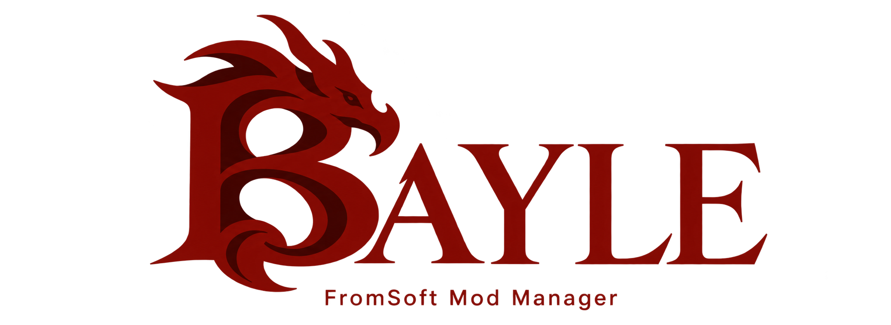

<div align="center">

<picture>
  <source media="(prefers-color-scheme: dark)" srcset="docs/assets/brand/bayle-wordmark-dark.png">
  
</picture>

**An all-in-one toolkit for managing mods, profiles, and saves, with tools for resolving compatibility issues and merging mod changes.**

[](https://github.com/Carlomos7/bayle/releases/latest)
[](https://github.com/Carlomos7/bayle/actions/workflows/test.yml)
[](LICENSE)


</div>

Bayle Modding Suite (Bayle for short) is a desktop app that manages your me3 profiles and mods, edits mod settings, looks after your saves,
and launches the game. Pick a game and a profile at the top, then press **Launch**.

Bayle is an unofficial fan project and is not affiliated with or endorsed by FromSoftware or Bandai Namco.

## Features

- **Profiles and mods.** Install mods from `.zip`, `.7z`, `.rar`, a `.dll` or a folder, or by drag and drop.
  Reorder them with me3's rules, set per-mod options, and rename or duplicate a profile. Every change can be undone
  from Activity.
- **Mod Configs.** Edit a mod's `.ini`, `.cfg` or `.toml` settings as a form, or open any file in a code editor with
  syntax highlighting, find and replace, and error markers. Seamless Co-op settings have their own panel, with sharing
  for your group.
- **Merging.** Combine several parameter packs into one, and merge files that two mods both ship, against the game's
  own copies. Set up any mod as an overhaul: the launcher merges it on top of the mods before it and rebuilds it when
  they change.
- **Saves.** Check and repair saves, keep a library of save copies, and drag characters between saves or accounts.
  Every write is backed up, verified, and waits for the game to let go of the file.
- **Library.** Keep mods in one shared folder for all your profiles, adopt an existing setup into it, and export or
  import a profile to share it with friends.
- **Launch.** Launch with mods, offline or vanilla. The launcher checks for problems first, rebuilds merged mods that
  are out of date, and warns before you play online with changed game data.
- **Updates.** Signed updates in the app, on a Stable or a Beta channel. If a version can't start, Bayle still offers
  the next update, its logs and a way to report it.

Dark Souls III and Sekiro have placeholder pages until their support lands.

## Download

Get Bayle 6 from [Releases](https://github.com/Carlomos7/bayle/releases): `Bayle_<version>_x64-setup.exe`, installed
per user. Bayle 6 is in beta, so it is a pre-release there.

**Requirements:** Windows 10 or 11; Steam with Elden Ring or Nightreign; and
[me3](https://github.com/garyttierney/me3). Setup installs Microsoft Edge WebView2 Runtime if it is missing (Windows 11
includes it). Linux and the Steam Deck come later.

**Coming from Bayle 5?** Uninstall it first, then install Bayle 6: your mods, profiles, saves and Bayle 5's data stay
on your PC. The release notes say how to bring Bayle 5's settings and backups over. Bayle 5 (the Qt app) is kept on the
[`legacy/qt-desktop`](https://github.com/Carlomos7/bayle/tree/legacy/qt-desktop) branch.

Bayle explains itself in the app: **Help › How to use** (F1). The Bayle 5 guide stays on `legacy/qt-desktop`.

<details>
<summary><b>Windows blocked the install</b></summary>

The installer isn't code-signed yet, so SmartScreen or Defender can wrongly flag it. In SmartScreen choose **More
info**, then **Run anyway**. If Defender removed it, open **Windows Security → Virus & threat protection → Protection
history**, find the Bayle entry, and choose **Restore** (or **Allow on device**), then run the setup again. Your
settings and data are kept.

If you can, please share the detection name from Protection history, so we can report the false positive.

</details>

## Building from source

You need [uv](https://docs.astral.sh/uv/) (it installs Python 3.14 for you), [Rust](https://rustup.rs),
[Node.js](https://nodejs.org) 22 and [pnpm](https://pnpm.io).

```bash
git clone https://github.com/Carlomos7/bayle.git
cd bayle/apps/desktop/ui && pnpm install && cd ..
npx @tauri-apps/cli@2.12.4 dev     # the app (Bayle Dev), with the engine from source and a scratch data folder
```

The repository holds the engine, `apps/engine` (a uv project: `bayle-engine`, import `bayle`, no UI), and the desktop
app, `apps/desktop`: the Rust gateway and Tauri shell (a Cargo workspace) and the React UI in `ui/` (pnpm). The
engine's headless modes run from `apps/engine`: `uv run python -m bayle`. `apps/desktop/README.md` has the details.

### Tests and checks

```bash
# in apps/engine
uv run pytest                     # tests
uv run ruff check . && uv run ruff format --check .
uv run pyright                    # type checking
uv run lint-imports --no-cache    # import layers (contracts in pyproject.toml)
# in apps/desktop/ui
pnpm verify                       # API types, typecheck, lint, build and tests
# in apps/desktop
cargo test -p bayle-gateway -p bayle-desktop
```

`uvx pre-commit install --hook-type pre-commit --hook-type commit-msg` (from the repository root) runs the same checks
and the commit message check before every commit. `apps/engine/tests/integration` works on temporary copies of a real
save; it skips when none is available.

### Building a release

Releases are built and signed in CI only, where the update key is (`.github/workflows/desktop-release-build.yml`).
Locally, `uv run --project apps/engine python apps/desktop/scripts/build_engine.py` freezes the engine, and
`npx @tauri-apps/cli@2.12.4 build` in `apps/desktop/src-tauri` makes an unsigned Bayle Dev installer.

## Project layout

```text
apps/engine/src/bayle/        the engine: no UI (the app is apps/desktop: gateway/, src-tauri/, ui/)
├── modules/     the features: activity, coop, games, launch, mods, overhauls, saves, settings
├── adapters/    infrastructure: formats, filesystem, persistence, games, saves, merging, overhauls,
│                archives, integrations (Steam, me3), system
├── work/        jobs, events, progress, cancellation, the CPU worker pool
├── api/         the HTTP API (FastAPI), thin routers over the features
├── runtime/     building the engine: composition, ports, start-up and shutdown
└── resources/   shipped read-only data: game definitions, schemas, item lists
```

Features reach the database, the settings file and other programs only through ports the runtime binds; adapters use
the features' models and ports, never their workflows. `lint-imports` enforces this in CI; the reasons are in
[docs/architecture.md](docs/architecture.md). Technical decisions are recorded in [docs/decisions](docs/decisions).

## Contributing

`main` is the only long-lived branch (GitHub Flow). Work happens on short-lived `feat/...`, `fix/...`, `docs/...` and
`chore/...` branches, merged into `main` by pull request (squash merge, the PR title in Conventional Commit form).
Every pull request and push to `main` runs lint, type checks and tests on Windows and Linux.

Versions follow [SemVer 2.0](https://semver.org) (`X.Y.Z`; pre-releases such as `6.0.0-beta.1` on the Beta channel).
A release is built, signed and published by `.github/workflows/desktop-release-build.yml`, and its update manifest is
deployed from the `updates` branch; both wait for the owner's approval. See [CONTRIBUTING.md](CONTRIBUTING.md) and
[CHANGELOG.md](CHANGELOG.md) for the version history.

Issues and pull requests are welcome.

## License

[GNU General Public License v3.0 or later](LICENSE). Third-party notices are in
[THIRD_PARTY_NOTICES.md](THIRD_PARTY_NOTICES.md).

## Credits

- [me3](https://github.com/garyttierney/me3): the mod loader this launcher drives.
- [Seamless Co-op](https://www.nexusmods.com/eldenring/mods/510): the co-op mod whose settings the launcher edits.
- [SoulsFormatsNEXT](https://github.com/soulsmods/SoulsFormatsNEXT), after TKGP's SoulsFormats: file layouts, and the
  animation event (TAE) reader and writer ported from it.
- [Soulstruct](https://github.com/Grimrukh/soulstruct) and [constrata](https://github.com/Grimrukh/constrata) by
  Grimrukh: the talk script (ESD) reader and writer, and the binary structure library.
- [ER-Save-Editor](https://github.com/ClayAmore/ER-Save-Editor) by ClayAmore: save layout and item ID tables.
- [UXM Selective Unpack](https://github.com/Nordgaren/UXM-Selective-Unpack) by Nordgaren, after TKGP's UXM: the game
  archive keys.
- [me3-manager](https://github.com/2Pz/me3-manager) by 2Pz.
- [Tauri](https://tauri.app): the desktop shell, installer and updater.
- Fonts: Cormorant Garamond and Geist.

Full license texts and every bundled library are listed in [THIRD_PARTY_NOTICES.md](THIRD_PARTY_NOTICES.md).
