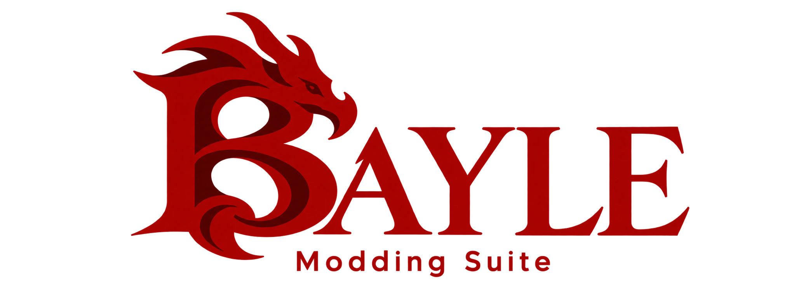

<div align="center">



**An all-in-one toolkit for managing mods, profiles, and saves, with tools for resolving compatibility issues and merging mod changes.**

[](https://github.com/Carlomos7/roundtable-souls/releases/latest)
[](https://github.com/Carlomos7/roundtable-souls/actions/workflows/test.yml)
[](LICENSE)


</div>

Bayle Modding Suite (Bayle for short) is a desktop app that manages your me3 profiles and mods, edits mod settings, looks after your saves,
and launches the game. Pick a game and a profile at the top, then press **Launch**.

Bayle is an unofficial fan project and is not affiliated with or endorsed by FromSoftware or Bandai Namco.

## Features

- **Profiles and mods.** Install mods from `.zip`, `.7z`, `.rar`, a `.dll` or a folder, or by drag and drop.
  Reorder them with me3's rules, set per-mod options, and rename or duplicate a profile. Every change can be undone
  from Activity.
- **Mod Configs.** Edit a mod's `.ini`, `.cfg` or `.toml` settings as a form, or open any file in a code editor with
  syntax highlighting, find and replace, and error markers. Seamless Co-op settings have their own panel, with sharing
  for your group.
- **Merging.** Combine several parameter packs into one, and merge files that two mods both ship, against the game's
  own copies. Set up any mod as an overhaul: the launcher merges it on top of the mods before it and rebuilds it when
  they change.
- **Saves.** Check and repair saves, keep a library of save copies, and drag characters between saves or accounts.
  Every write is backed up, verified, and waits for the game to let go of the file.
- **Library.** Keep mods in one shared folder for all your profiles, adopt an existing setup into it, and export or
  import a profile to share it with friends.
- **Launch.** Launch with mods, offline or vanilla. The launcher checks for problems first, rebuilds merged mods that
  are out of date, and warns before you play online with changed game data.
- **Updates.** Signed updates through Velopack, a Stable and a Beta channel, and an automatic rollback if a new version
  fails to start.
- **Steam and Steam Deck.** `--game er --play` runs a full session without the window, for a Steam shortcut or
  Gaming Mode.

Dark Souls III and Sekiro have placeholder pages until their support lands.

## Download

Get the latest version from [Releases](https://github.com/Carlomos7/roundtable-souls/releases/latest).

| File | For |
| --- | --- |
| `RoundtableSouls-Setup.exe` | Windows, installed per user (recommended) |
| `RoundtableSouls-win-Portable.zip` | Windows, portable |
| `RoundtableSouls-linux-x86_64.AppImage` | Linux and Steam Deck |
| `SHA256SUMS.txt` (+ `.minisig`) | Signed checksums for every file |

**Requirements:** Windows 10 or 11, or Linux (including SteamOS); Steam with Elden Ring or Nightreign; and
[me3](https://github.com/garyttierney/me3).

The full guide is in [docs/How to use.txt](docs/How%20to%20use.txt).

<details>
<summary><b>Windows Defender blocked the install or an update</b></summary>

The launcher isn't code-signed yet, so Defender can wrongly flag it. Setup may say *"Install Partially Succeeded"* or
show error `-2147024671`.

1. Open **Windows Security → Virus & threat protection → Protection history**, find the Bayle entry, and
   choose **Restore** (or **Allow on device**).
2. Under **Manage settings → Exclusions**, add the folder `%LOCALAPPDATA%\Carlomos7.RoundtableSouls`.
3. Run `RoundtableSouls-Setup.exe` again and choose **Repair**. Your settings and data are kept.

If you can, please share the detection name from Protection history, so we can report the false positive.

</details>

## Command line

```bash
RoundtableSouls                       # the window, on the game used last
RoundtableSouls --game nr             # the window, on Nightreign (this run only)
RoundtableSouls --game er --play      # Launch Elden Ring without the window (Steam shortcut)
RoundtableSouls --game nr --check     # print what was detected for Nightreign
RoundtableSouls --update              # update without the window, then restart
```

## Building from source

You need [uv](https://docs.astral.sh/uv/); it installs Python 3.14 for you.

```bash
git clone https://github.com/Carlomos7/roundtable-souls.git
cd roundtable-souls
cd apps/qt-desktop
uv sync
uv run python -m bayle_qt           # the window
```

The repository holds two independent uv projects, each with its own `uv.lock` and virtual environment:
`apps/engine` (`bayle-engine`, import `bayle`, no Qt) and `apps/qt-desktop` (`bayle-qt`, import `bayle_qt`; it uses the
engine as an editable path dependency). The engine's headless modes run from `apps/engine`: `uv run python -m bayle`.

### Tests and checks

Run these in `apps/engine` and in `apps/qt-desktop` (the Qt tests run offscreen).

```bash
uv run pytest                     # tests
uv run ruff check . && uv run ruff format --check .
uv run pyright                    # type checking
uv run lint-imports --no-cache    # import layers (contracts in the project's pyproject.toml)
uv run pre-commit install --hook-type pre-commit --hook-type commit-msg   # the same checks and the commit message check before every commit
```

`apps/engine/tests/integration` works on temporary copies of a real save; it skips when none is available.

### Building a release

In `apps/qt-desktop`:

```bash
uv run python scripts/build.py                       # PyInstaller, then vpk pack into dist/
uv run python scripts/build.py --identity test.json  # an isolated test build (own app ID, data folder and feed)
```

`vpk` comes from `dotnet tool install -g vpk --version 1.2.161`.

## Project layout

```text
apps/engine/src/bayle/        the engine: no Qt (the window, pages and updater are apps/qt-desktop/src/bayle_qt/)
├── modules/     the features: activity, coop, games, launch, mods, overhauls, saves, settings
├── adapters/    infrastructure: formats, filesystem, persistence, games, saves, merging, overhauls,
│                archives, integrations (Steam, me3), system
├── work/        jobs, events, progress, cancellation, the CPU worker pool
├── api/         the HTTP API (FastAPI), thin routers over the features
├── runtime/     building the engine: composition, ports, start-up and shutdown
└── resources/   shipped read-only data: game definitions, schemas, item lists
```

Features reach the database, the settings file and other programs only through ports the runtime binds; adapters use
the features' models and ports, never their workflows. `lint-imports` enforces this in CI; the reasons are in
[docs/architecture.md](docs/architecture.md). Technical decisions are recorded in [docs/decisions](docs/decisions).

## Contributing

`main` is the only long-lived branch (GitHub Flow). Work happens on short-lived `feat/...`, `fix/...`, `docs/...` and
`chore/...` branches, merged into `main` by pull request (squash merge, the PR title in Conventional Commit form).
Every pull request and push to `main` runs lint, type checks and tests on Windows and Linux.

Versions follow [SemVer 2.0](https://semver.org) (`X.Y.Z`, pre-releases `X.Y.Z-rc.N` on the Beta channel). Releases are
cut by release-please from the Conventional Commits; merging its release pull request tags `vX.Y.Z`, and the tag builds,
tests, signs and publishes the release (`.github/workflows/release.yml`). See [CONTRIBUTING.md](CONTRIBUTING.md) and
[CHANGELOG.md](CHANGELOG.md) for the version history.

Issues and pull requests are welcome.

## License

[GNU General Public License v3.0 or later](LICENSE). Third-party notices are in
[THIRD_PARTY_NOTICES.md](THIRD_PARTY_NOTICES.md).

## Credits

- [me3](https://github.com/garyttierney/me3): the mod loader this launcher drives.
- [Seamless Co-op](https://www.nexusmods.com/eldenring/mods/510): the co-op mod whose settings the launcher edits.
- [SoulsFormatsNEXT](https://github.com/soulsmods/SoulsFormatsNEXT), after TKGP's SoulsFormats: file layouts, and the
  animation event (TAE) reader and writer ported from it.
- [Soulstruct](https://github.com/Grimrukh/soulstruct) and [constrata](https://github.com/Grimrukh/constrata) by
  Grimrukh: the talk script (ESD) reader and writer, and the binary structure library.
- [ER-Save-Editor](https://github.com/ClayAmore/ER-Save-Editor) by ClayAmore: save layout and item ID tables.
- [UXM Selective Unpack](https://github.com/Nordgaren/UXM-Selective-Unpack) by Nordgaren, after TKGP's UXM: the game
  archive keys.
- [me3-manager](https://github.com/2Pz/me3-manager) by 2Pz.
- [Velopack](https://github.com/velopack/velopack): installs and updates.
- Fonts (Cormorant Garamond, EB Garamond, Inter) and
  [Fluent UI System Icons](https://github.com/microsoft/fluentui-system-icons).

Full license texts and every bundled library are listed in [THIRD_PARTY_NOTICES.md](THIRD_PARTY_NOTICES.md).
