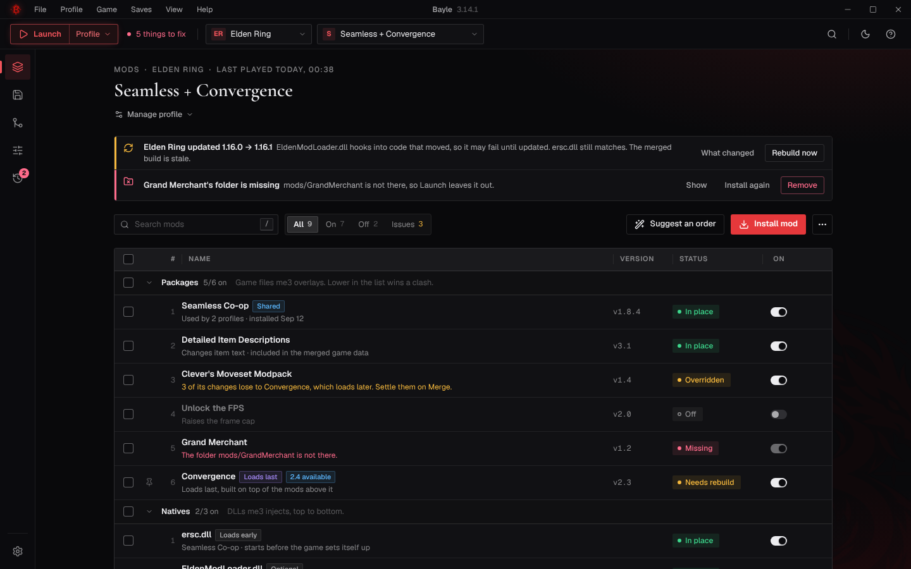

# Bayle UI

Bayle's desktop interface. In the desktop app (Tauri 2) it talks to Bayle's
Python engine only through the Rust gateway; in a browser it runs on an
in-memory mock engine for development. See [docs/INTEGRATION.md](docs/INTEGRATION.md).

| Area | Uses |
|---|---|
| Core | React 19, TypeScript (strict), Vite, pnpm |
| Routing | TanStack Router (file-based, type-safe search params, hash history) |
| Server state | TanStack Query |
| Components | shadcn/ui on Radix UI, Lucide icons, cmdk |
| Styling | Tailwind CSS 4, theme variables, `tw-animate-css` |
| Forms | React Hook Form + Zod |
| Notifications | Sonner |
| Motion | CSS transitions only; no animation library is needed yet |



More in [docs/screenshots](docs/screenshots): Mods (Dark, Light), Saves, Mod Configs, Activity, Settings.

## Quick start

Needs Node 20.19+ and pnpm 10 (`corepack enable` picks the pinned version).

```bash
pnpm i
pnpm dev           # http://localhost:5173, runs on the mock engine ("Preview data")
```

Engine states in the preview: add `?engine=slow`, `?engine=fail` or
`?engine=incompatible` before the `#`. In the browser console,
`__bayleEngine.crash()`, `.fail()`, `.incompatible()` and `.restart()` drive
the mock engine.

Everything works in the mock: install, toggle, drag to reorder, bulk actions,
undo from any toast or from Activity, saves and character copies, config
editing, overhaul setups, themes. Data resets on reload. The mock's file
picker alternates between a plain mod and the Nightreign Revive overhaul, so
Install shows both paths.

| Script | Does |
|---|---|
| `pnpm dev` | Dev server on the mock engine |
| `pnpm build` | Desktop build in `dist/` for Tauri: no mock inside; in a plain browser it only says to open the app |
| `pnpm build:demo` | Browser demo in `dist-demo/`, on the mock engine, labelled "Preview data" |
| `pnpm typecheck` | Generate routes, then TypeScript (app and tests) |
| `pnpm lint` | ESLint |
| `pnpm test` | Unit tests (Vitest): jobs, engine lifecycle, gateway, the security boundary |
| `pnpm verify` | typecheck, lint, build, test |
| `pnpm routes` | Regenerate `src/routeTree.gen.ts` (the dev server also does this on save) |

Add more shadcn components with `pnpm dlx shadcn@latest add <name>`;
`components.json` is set up, and they pick up the Bayle themes.

## Desktop integration

Read **[docs/INTEGRATION.md](docs/INTEGRATION.md)**: the audit, the proposed
Rust gateway contract, jobs and engine states, what is wired and what is
still mocked, and the handoff for the Tauri/Rust work. In short: pages call
`BayleApi` through hooks; `src/api/gateway/` is the only code that knows
about Tauri; React never sees the engine's port, token or URLs.

## Project layout

```
src/
  api/            types.ts + BayleApi.ts (what the UI needs), index.ts (picks desktop or preview),
                  gateway/ (Tauri transport, hub, protocol proposal, production adapter, mock engine),
                  mock/ (the mock BayleApi), preview.ts (the browser preview; stubbed out of desktop builds)
  routes/         TanStack Router file routes: /mods, /merge, /configs, /settings (with search params), /saves, /activity
  routeTree.gen.ts  generated; don't edit
  router.ts       router instance (hash history so file:// works)
  data/           query hooks, useAction (change → toast + Undo), cache keys, event listener,
                  engine.ts + jobState.ts (engine lifecycle and jobs)
  state/          UI-only stores: game, launch mode, dialogs; toast() over Sonner
  components/ui/  shadcn/ui primitives (button, dialog, sheet, dropdown-menu, command, form, …)
  components/bayle/  Bayle compositions on top: Dialog, Sheet, menus, Segmented, NameDialog,
                  Tag, StatusChip, FileTree, page layout pieces
  lib/utils.ts    cn() and small helpers
  app/            layout, nav helpers (useGo, usePage), shell (menu bar, top bar, rail,
                  command palette, global dialogs), theme, shortcuts
  features/
    mods/         table, groups, selection + bulk bar, drag reorder, mod panel (with its Clashes tab), install, flows
    merge/        the merged game data: one status line, Needs you, where mods overlap (one row per kind, a rule per kind, each piece as a stack), Not merged, your rules, the Not built yet bar, and the board, plan and report under Advanced
    configs/      settings files as forms or text
    overhaul/     overhaul setup: files, natives, review
    saves/        library, live saves, slots, character copy, drag and drop, backups
    activity/     timeline, filters, logs, undo
    settings/     sticky nav, search, changed-from-default, themes
  styles/         Tailwind + theme variables (Dark, Bayle, Tarnished, Light)
docs/             INTEGRATION.md (desktop integration), ARCHITECTURE.md (how the UI is built)
```

See **[docs/ARCHITECTURE.md](docs/ARCHITECTURE.md)** for the layers, styling
rules and conventions.

## Tested

- Pages run on mock data. Only Activity is wired to the engine, and only on the frontend side: nothing has run against the real gateway yet.
- `pnpm typecheck`, `pnpm lint`, `pnpm build` and `pnpm test` (54 unit tests) are clean.
- Every page was clicked through in a real browser (189 scripted checks):
  selection and bulk actions, drag reorder, undo from toasts and from
  Activity, the mod panel tabs, config forms with unsaved-changes handling,
  the overhaul setup steps, save copies by menu and by drag and drop, settings
  search and reset, every theme, the command palette and keyboard shortcuts,
  routes and search params, form validation, the Merge page (two levels, search, filters, settling a clash and undoing it, rebuild, staleness after a reorder and after a mod update, the suggested order), the Before you play panel, the first-run flow and explainers, and narrow windows.

## Two levels, one door

Most people want to install mods and press Launch. The UI follows progressive disclosure the way Nielsen describes it: two levels, about 80% of tasks on the first, and one visible, consistent door to the second. No "advanced mode" toggle, no hidden pages, because people lose their place when the interface changes shape.

**Level one, on every page**
- Pages in the order people reach for them: Mods, Saves, Merge, Mod Configs, Activity, then Settings. Ctrl+1…6 follow.
- Next to Launch, one line: "Nothing to fix" or "3 things to fix". It opens **Before you play**, a panel with every problem and its one-click fix (Rebuild now, Turn it off for now, Install again or remove, Check them). Nobody has to know which page a problem lives on.
- Mods: the list, on/off, drag to reorder, Install mod. "Suggest who wins" appears only when mods actually overlap, and shows every suggestion with its reason and trade before applying.
- Merge: status and why it is stale, changes left out, picks that need a look, and "Something looks different in game?" (type what you saw, see which mod changed it).
- Install: the Plan, with the recipe's source and version check.

**Level two, always behind the same "Advanced" fold**
- Merge: who wins is decided in this order: your single pick, your rule for that kind, a rule that keeps a moveset together, then load order. Changes wait in a "Not built yet" bar with Undo until you rebuild. The board, plan and report sit under Advanced.
- Install: the file-by-file recipe.
- The mod panel: Options (package id, load after, native settings) sits beside Update, Clashes, Files and Config files.

**The first time**
- A three-screen welcome, each one question, all skippable: where the games are, the mod loader, and what to do first (add a mod, import a modpack, look around). Help › Welcome tour brings it back.
- One-time explainer cards on Merge, Saves and the install plan, in plain words, gone for good once dismissed. Not tooltips: tooltips only help people who already know where to hover.
- Help › Words Bayle uses: the eight words, one line each.
- Empty states that say what the page is for and that there is nothing to do.

**What Bayle says, and what it doesn't**
- Words used everywhere: Merged, Won, Lost, Clash, Dropped, Whole file (a type Bayle does not merge; one copy used, compatibility unknown), Not checked (no evidence either way), Stale.
- Never "Ready" or "compatible": a mod is "In place", a merge is "Built, nothing changed since", the chip says "Nothing to fix". Whether the mods work in game is theirs to prove.
- Detected, suggested, executed are kept apart: the plan and the order suggestion are read only; Rebuild and Apply are the only things that write.
- Every merge names its baseline (the game build) and says which mods did not state what they were made against.
- "Keep both" for colliding rows needs your approval each time, and says that unknown references would break.
- A DLL after a game update is ok, may fail, or unknown, and unknown is shown as unknown.
- The word "overhaul" does not appear: every mod is files plus a recipe, and one that must load last is tagged "Loads last".

**Friends on the same setup**
- Mods › ⋯ › Share setup with friends: a file of names, versions and fingerprints, no mod files. Compare with a friend's file and see each difference with what it means for playing together.

## Known gaps

- "Export profile", "Edit as text" on the Mods page, and "Show first-run tips
  again" show a placeholder toast; the HTML prototype didn't define them yet.
- The Steam account in the Saves header is sample text until the backend
  provides it (add it to `Game` or `SaveFile` when you know the source).
- Folder sizes for backups and logs aren't in the contract yet.
